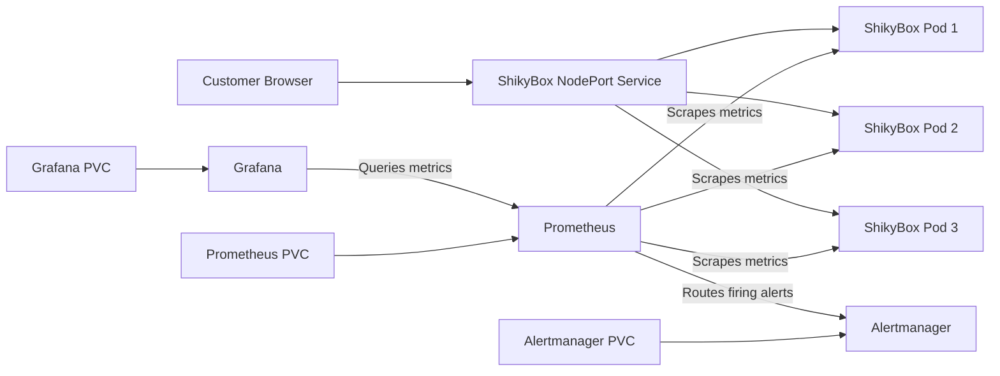
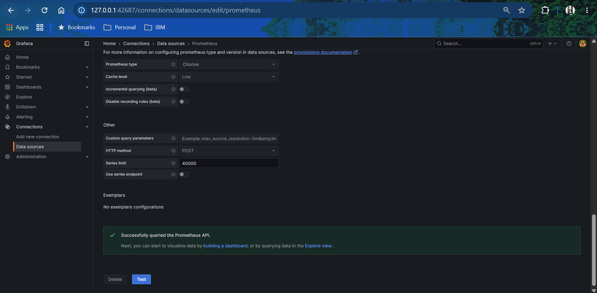
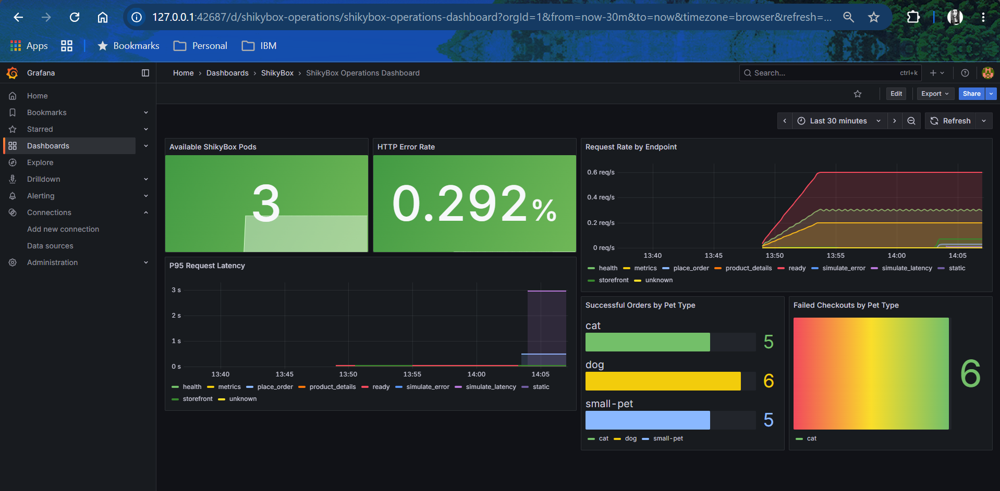
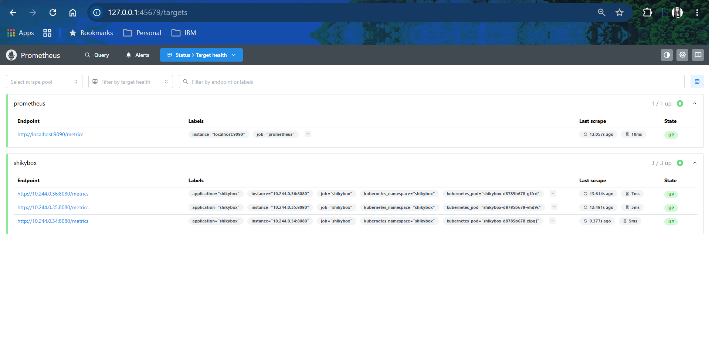
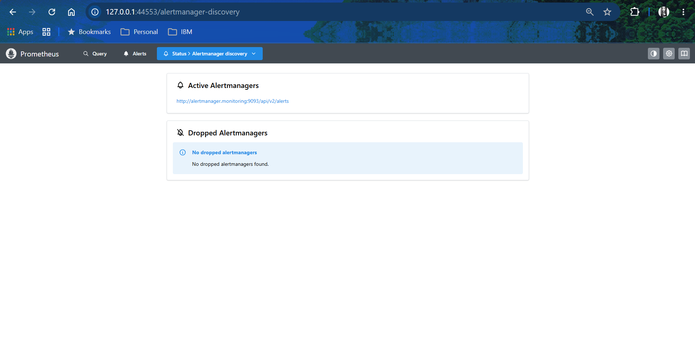
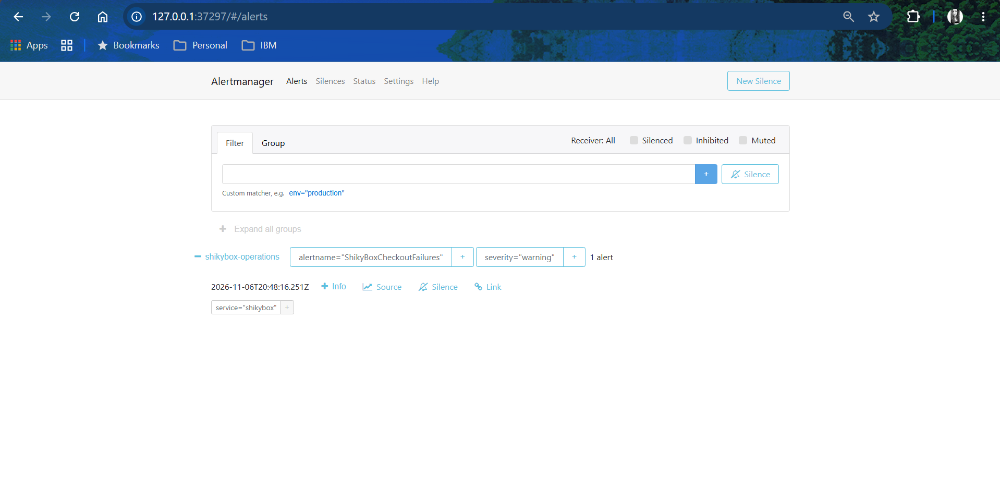
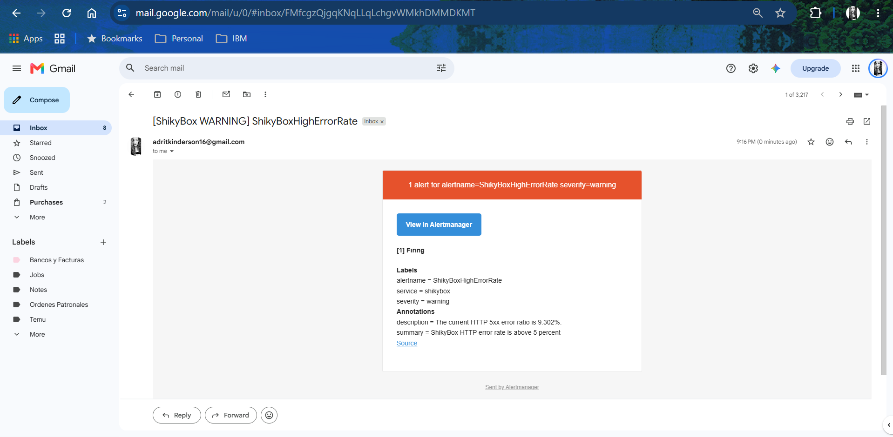
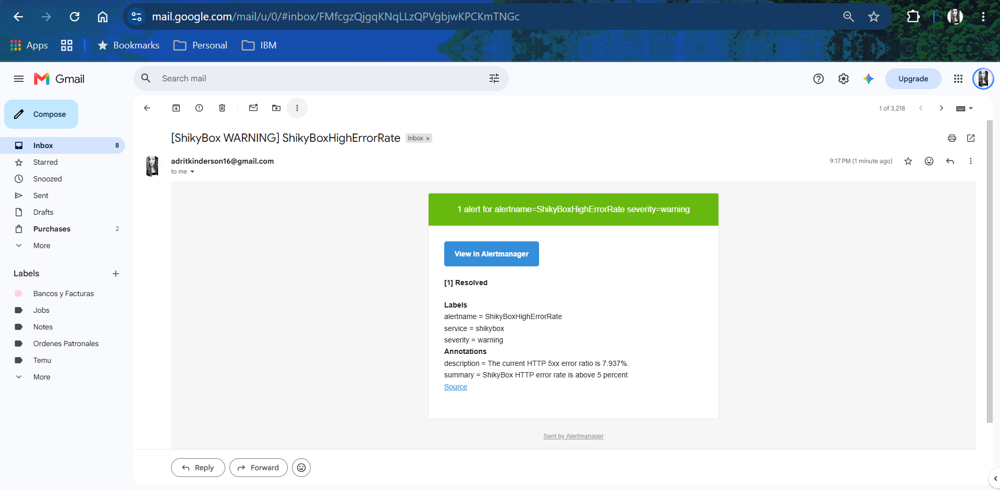

# ShikyBox

ShikyBox is a pet subscription storefront where customers can explore monthly surprise boxes for dogs, cats, and small pets and place orders through a responsive web interface.

Behind the storefront, ShikyBox demonstrates reliable cloud-native operations through Kubernetes health probes, Prometheus metrics, Grafana dashboards, persistent monitoring storage, and Alertmanager-based incident detection.

## Table of Contents

- [Project Requirements](#project-requirements)
- [Bonus Features](#bonus-features)
- [Project Purpose](#project-purpose)
- [Architecture](#architecture)
- [Main Components](#main-components)
- [ShikyBox Features](#shikybox-features)
  - [Customer Experience](#customer-experience)
  - [Reliability and Observability](#reliability-and-observability)
- [Application Endpoints](#application-endpoints)
- [Prometheus Metrics](#prometheus-metrics)
- [Prometheus Alert Rules](#prometheus-alert-rules)
- [Alert Routing](#alert-routing)
  - [External Email Notifications](#external-email-notifications)
- [Controlled Alert Testing](#controlled-alert-testing)
  - [Generate Checkout Failures](#generate-checkout-failures)
  - [Generate HTTP Errors](#generate-http-errors)
  - [Generate High Latency](#generate-high-latency)
- [Repository Structure](#repository-structure)
- [Prerequisites](#prerequisites)
- [Resource Namespaces](#resource-namespaces)
- [Local Development](#local-development)
- [Docker Image](#docker-image)
- [Build the Image Inside Minikube](#build-the-image-inside-minikube)
- [Kubernetes Deployment](#kubernetes-deployment)
- [Prometheus Deployment](#prometheus-deployment)
  - [Prometheus Persistent Storage](#prometheus-persistent-storage)
- [Grafana Deployment](#grafana-deployment)
- [Alertmanager Deployment](#alertmanager-deployment)
  - [Configure Gmail Notifications](#configure-gmail-notifications)
- [Persistent Storage](#persistent-storage)
- [Implementation Evidence](#implementation-evidence)
  - [Grafana Prometheus Data Source](#grafana-prometheus-data-source)
  - [ShikyBox Operations Dashboard](#shikybox-operations-dashboard)
  - [Prometheus ShikyBox Targets](#prometheus-shikybox-targets)
  - [Prometheus Alertmanager Discovery](#prometheus-alertmanager-discovery)
  - [Alertmanager Checkout Alert](#alertmanager-checkout-alert)
  - [External Email Warning Notification](#external-email-warning-notification)
  - [External Email Resolved Notification](#external-email-resolved-notification)
- [License](#license)
- [Contributing](#contributing)

## Project Requirements

- [x] 1. Instrumented application
- [x] 2. Kubernetes deployment
- [x] 3. Prometheus integration
- [x] 4. Grafana visualization
- [x] 5. Alertmanager deployment
- [x] 6. Professional documentation

## Bonus Features

- [x] Advanced Alertmanager email notifications through Gmail SMTP
- [ ] Infrastructure as Code implementation
- [ ] CI/CD pipeline integration

## Project Purpose

ShikyBox was developed to demonstrate practical Site Reliability Engineering skills through a small but realistic customer-facing application.

The project combines:

- Application instrumentation
- Containerization with Docker
- Kubernetes orchestration
- Health and readiness probes
- Prometheus metrics collection
- Grafana visualization
- Alert evaluation and routing
- Persistent monitoring storage
- Operational troubleshooting and documentation

## Architecture

## Main Components

| Component | Purpose |
|---|---|
| ShikyBox Flask application | Customer storefront, simulated orders, health probes, and Prometheus metrics |
| Docker | Builds a reproducible Linux AMD64 application image |
| Kubernetes | Manages application scheduling, replicas, health probes, services, and rolling updates |
| Prometheus | Collects metrics, discovers Kubernetes pods, evaluates alert rules, and forwards alerts |
| Grafana | Displays the ShikyBox operations dashboard and queries Prometheus |
| Alertmanager | Groups, routes, inhibits, and displays alerts generated by Prometheus |
| PersistentVolumeClaims | Preserve data for Prometheus, Grafana, and Alertmanager |
| Kustomize | Organizes and deploys the Kubernetes resources declaratively |

## ShikyBox Features

### Customer Experience

- Three monthly pet subscription boxes
- Boxes for dogs, cats, and small pets
- Product detail pages
- Successful checkout simulation
- Failed checkout simulation
- Responsive storefront for desktop and mobile devices
- Customer-focused About page
- Monthly subscription pricing and box contents

### Reliability and Observability

- Three Kubernetes application replicas
- Kubernetes liveness and readiness probes
- Prometheus-compatible metrics endpoint
- Automatic Kubernetes pod discovery
- Request, error, latency, product-view, and order metrics
- Controlled HTTP error simulation
- Controlled request-latency simulation
- Persistent monitoring storage
- Grafana dashboard provisioning
- Prometheus alert evaluation
- Alertmanager grouping and routing

## Application Endpoints

| Endpoint | Method | Purpose |
|---|---|---|
| `/` | GET | Displays the ShikyBox storefront |
| `/box/<product_id>` | GET | Displays the selected subscription box |
| `/order/<product_id>` | POST | Creates a simulated successful order |
| `/order/<product_id>?fail=true` | POST | Generates a controlled failed checkout |
| `/about` | GET | Displays the ShikyBox story and customer information |
| `/health` | GET | Kubernetes liveness probe |
| `/ready` | GET | Kubernetes readiness probe |
| `/metrics` | GET | Exposes Prometheus metrics |
| `/simulate/error` | GET | Generates a controlled HTTP 500 response |
| `/simulate/latency?seconds=2` | GET | Generates a controlled slow response |

## Prometheus Metrics

ShikyBox exposes application, reliability, and business metrics through the `/metrics` endpoint.

| Metric | Type | Description |
|---|---|---|
| `shikybox_http_requests_total` | Counter | Total HTTP requests by method, endpoint, and status |
| `shikybox_http_errors_total` | Counter | Total HTTP error responses by endpoint and status |
| `shikybox_request_duration_seconds` | Histogram | Request latency distribution used for percentile calculations |
| `shikybox_product_views_total` | Counter | Product detail views grouped by pet-box type |
| `shikybox_orders_total` | Counter | Successful simulated orders grouped by pet-box type |
| `shikybox_order_failures_total` | Counter | Failed simulated orders grouped by box type and reason |
| `shikybox_orders_in_progress` | Gauge | Number of orders currently being processed |
| `shikybox_app_info` | Info | Application name, version, and environment information |

Prometheus uses Kubernetes pod discovery to find the three ShikyBox replicas. Each application pod includes these annotations:

- `prometheus.io/scrape: "true"`
- `prometheus.io/path: "/metrics"`
- `prometheus.io/port: "8080"`

Prometheus scrapes the discovered pods every 15 seconds.

## Prometheus Alert Rules

Prometheus evaluates five alert rules defined in `monitoring/prometheus/alert-rules.yaml`.

| Alert | Severity | Trigger Condition |
|---|---|---|
| `ShikyBoxUnavailable` | Critical | No ShikyBox target is available for 1 minute |
| `ShikyBoxReplicaDegraded` | Warning | Fewer than three ShikyBox targets are available for 1 minute |
| `ShikyBoxHighErrorRate` | Warning | HTTP 5xx error ratio exceeds 5 percent |
| `ShikyBoxHighLatency` | Warning | P95 request latency exceeds 1 second |
| `ShikyBoxCheckoutFailures` | Warning | At least three checkout failures occur within 5 minutes |

## Alert Routing

Prometheus sends firing alerts to the internal Alertmanager service: `http://alertmanager.monitoring:9093`

Alertmanager groups alerts by alert name and severity.

| Receiver | Severity | Purpose |
|---|---|---|
| `shikybox-operations` | Warning | Routes operational warnings such as latency, degraded replicas, and checkout failures |
| `shikybox-critical` | Critical | Routes service-unavailable alerts requiring immediate attention |

Alertmanager also includes an inhibition rule that suppresses related warning alerts when a critical alert for the same condition is active.

### External Email Notifications

Alertmanager sends warning and critical incident notifications through Gmail SMTP.

| Setting | Value |
|---|---|
| SMTP server | `smtp.gmail.com:587` |
| TLS | Required |
| Warning receiver | `shikybox-operations` |
| Critical receiver | `shikybox-critical` |
| Resolved notifications | Enabled |
| Credential source | Kubernetes Secret mounted as a read-only file |

The Gmail App Password is stored in the `shikybox-email` Kubernetes Secret under the `smtp-password` key.

The Secret was created directly in the Kubernetes cluster and is not stored in this Git repository.

Alert flow:

1. ShikyBox emits application metrics.
2. Prometheus evaluates the configured alert rules.
3. Prometheus sends firing alerts to Alertmanager.
4. Alertmanager groups and routes the alert.
5. Alertmanager authenticates to Gmail SMTP using the mounted Secret.
6. Gmail delivers the external warning or critical notification.
7. Alertmanager sends a resolved notification after the alert condition clears.

## Controlled Alert Testing

ShikyBox provides safe simulation endpoints for testing monitoring and alerting without damaging the deployment.

### Generate checkout failures

Replace the URL with the value returned by `minikube service shikybox -n shikybox --url`.

    SHIKYBOX_URL="http://127.0.0.1:REPLACE_PORT"

    for i in $(seq 1 10); do
      curl -s -o /dev/null -X POST \
        "$SHIKYBOX_URL/order/cat-comfort?fail=true"
      sleep 1
    done

After the Prometheus evaluation interval and configured pending period, the `ShikyBoxCheckoutFailures` alert changes through these states:

1. `Inactive`
2. `Pending`
3. `Firing`

Prometheus then forwards the firing alert to Alertmanager, where the alert is grouped under the `shikybox-operations` receiver.

### Generate HTTP errors

    for i in $(seq 1 10); do
      curl -s -o /dev/null \
        "$SHIKYBOX_URL/simulate/error"
      sleep 1
    done

### Generate high latency

    for i in $(seq 1 5); do
      curl -s -o /dev/null \
        "$SHIKYBOX_URL/simulate/latency?seconds=2"
    done

## Repository Structure

The repository separates application code, Kubernetes resources, monitoring components, tests, and implementation evidence.

    sre-academy-final-project/
    ├── app/
    │   ├── static/
    │   │   └── css/
    │   │       └── style.css
    │   ├── templates/
    │   │   ├── about.html
    │   │   ├── index.html
    │   │   └── product.html
    │   ├── __init__.py
    │   ├── app.py
    │   ├── catalog.py
    │   ├── metrics.py
    │   └── requirements.txt
    ├── kubernetes/
    │   ├── deployment.yaml
    │   ├── kustomization.yaml
    │   ├── namespace.yaml
    │   └── service.yaml
    ├── monitoring/
    │   ├── alertmanager/
    │   │   ├── configmap.yaml
    │   │   ├── deployment.yaml
    │   │   ├── kustomization.yaml
    │   │   ├── pvc.yaml
    │   │   └── service.yaml
    │   ├── grafana/
    │   │   ├── dashboard-provider.yaml
    │   │   ├── dashboard.yaml
    │   │   ├── datasource.yaml
    │   │   ├── deployment.yaml
    │   │   ├── kustomization.yaml
    │   │   ├── pvc.yaml
    │   │   └── service.yaml
    │   └── prometheus/
    │       ├── alert-rules.yaml
    │       ├── configmap.yaml
    │       ├── deployment.yaml
    │       ├── kustomization.yaml
    │       ├── namespace.yaml
    │       ├── pvc.yaml
    │       ├── rbac.yaml
    │       └── service.yaml
    ├── screenshots/
    ├── tests/
    │   └── test_app.py
    ├── .dockerignore
    ├── .gitignore
    ├── CONTRIBUTING.md
    ├── Dockerfile
    ├── LICENSE.md
    └── README.md

## Prerequisites

ShikyBox was validated using Ubuntu on Windows Subsystem for Linux 2 with Minikube and the Docker driver.

Install and configure the following tools before deploying the project:

| Tool | Purpose |
|---|---|
| Git | Source control and project versioning |
| Python 3 | Local application development and testing |
| Docker | Container image creation |
| Minikube | Local Kubernetes cluster |
| kubectl | Kubernetes resource management |
| Kustomize | Declarative resource deployment through `kubectl -k` |
| curl | Endpoint and API validation |

Recommended Minikube resources:

| Resource | Recommended Value |
|---|---:|
| CPUs | 4 or more |
| Memory | 6 GiB or more |
| Disk | 30 GiB or more |

Confirm the required tools:

    git --version
    python3 --version
    docker --version
    minikube version
    kubectl version --client

Confirm that Minikube is running:

    minikube status

## Resource Namespaces

The project uses two Kubernetes namespaces:

| Namespace | Resources |
|---|---|
| `shikybox` | ShikyBox Deployment, pods, and NodePort Service |
| `monitoring` | Prometheus, Grafana, Alertmanager, ConfigMaps, Services, RBAC, and persistent storage |

Inspect the namespaces:

    kubectl get namespace shikybox
    kubectl get namespace monitoring

## Local Development

Clone the repository and enter the project directory:

    git clone https://github.com/adritkinderson16-blip/sre-academy-final-project.git
    cd sre-academy-final-project

Create a Python virtual environment:

    python3 -m venv .venv

Activate the environment:

    source .venv/bin/activate

Upgrade `pip` and install the application dependencies:

    python -m pip install --upgrade pip
    python -m pip install -r app/requirements.txt

Run the automated tests:

    python -m pytest -v

Expected result:

    9 passed

Start ShikyBox locally:

    python -m app.app

The application listens on: 

    http://localhost:8080

Test a successful order:

    curl -s -X POST \
      http://localhost:8080/order/dog-adventure |
      python3 -m json.tool

Test a controlled checkout failure:

    curl -s -X POST \
      "http://localhost:8080/order/cat-comfort?fail=true" |
      python3 -m json.tool

## Docker Image

ShikyBox uses a Python 3.11 slim image and runs with Gunicorn as a non-root user.

Build the image for Linux AMD64:

    docker build \
      --platform linux/amd64 \
      -t shikybox:1.0.0 \
      .

Run the container:

    docker run --rm \
      --name shikybox \
      -p 8080:8080 \
      -e ENVIRONMENT=container \
      -e APP_VERSION=1.0.0 \
      shikybox:1.0.0

Open the containerized storefront:

    http://localhost:8080

## Build the Image Inside Minikube

The Kubernetes Deployment uses a locally built image:

    image: shikybox:1.0.0
    imagePullPolicy: Never

Point the Docker CLI to the current Minikube Docker daemon:

    eval "$(minikube docker-env)"

Build ShikyBox inside Minikube:

    docker build \
      --platform linux/amd64 \
      -t shikybox:1.0.0 \
      .

Confirm that the image is available:

    docker images | grep shikybox

## Kubernetes Deployment

ShikyBox is deployed as three Kubernetes replicas in the `shikybox` namespace.

The Deployment includes:

- Three application replicas
- Rolling-update strategy
- Zero unavailable replicas during updates
- Liveness probe using `/health`
- Readiness probe using `/ready`
- CPU and memory requests and limits
- Prometheus scrape annotations

Deploy the application:

    kubectl apply -k kubernetes

Validate the resources:

    kubectl get all -n shikybox

Expected state:

- Three ShikyBox pods are `1/1 Running`
- The Deployment is `3/3 Available`
- The NodePort Service exposes port `8080` through node port `30080`

## Prometheus Deployment

Prometheus uses Kubernetes pod discovery to scrape all annotated ShikyBox replicas.

The Prometheus resources include:

- ServiceAccount
- ClusterRole
- ClusterRoleBinding
- Scrape configuration
- Five ShikyBox alert rules
- PersistentVolumeClaim with `5Gi`
- NodePort Service
- `Recreate` Deployment strategy

Deploy Prometheus:

    kubectl apply -k monitoring/prometheus

Access Prometheus:

    minikube service prometheus \
      -n monitoring \
      --url

In the Prometheus query interface, run:

    up{job="shikybox"}

Expected result:

- Three ShikyBox time series
- Each target has a value of `1`

### Prometheus Persistent Storage

Prometheus stores time-series data in the `prometheus-data` PersistentVolumeClaim.

    kubectl get pvc prometheus-data -n monitoring

Expected state:

    Bound

## Grafana Deployment

Grafana is automatically provisioned with:

- Prometheus as the default data source
- The ShikyBox dashboard provider
- The ShikyBox Operations Dashboard
- PersistentVolumeClaim with `2Gi`
- NodePort Service

Deploy Grafana:

    kubectl apply -k monitoring/grafana

Access Grafana:

    minikube service grafana \
      -n monitoring \
      --url

Default local credentials:

    Username: admin
    Password: admin

Open the provisioned dashboard:

    Dashboards → ShikyBox → ShikyBox Operations Dashboard

The dashboard contains six panels:

1. Available ShikyBox Pods
2. HTTP Error Rate
3. Request Rate by Endpoint
4. P95 Request Latency
5. Successful Orders by Pet Type
6. Failed Checkouts by Pet Type

## Alertmanager Deployment

Alertmanager provides alert grouping, routing, inhibition, silencing, and alert-status visibility. The Alertmanager resources include:
- Routing configuration
- Warning and critical receivers
- Inhibition rules
- PersistentVolumeClaim with `1Gi`
- NodePort Service

Deploy Prometheus before completing this section. The Prometheus Kustomize configuration creates the `monitoring` namespace required by the Gmail Secret and Alertmanager resources.

### Configure Gmail Notifications

The Alertmanager Deployment expects a Kubernetes Secret named `shikybox-email`. The Secret is intentionally excluded from Git because it contains the Gmail App Password.

Before deploying Alertmanager:

1. Enable 2-Step Verification on the Gmail sender account.
2. Create a Google App Password named `ShikyBox Alertmanager`.
3. Update the sender and recipient addresses in `monitoring/alertmanager/configmap.yaml` when using a different Gmail account.
4. Create the SMTP password Secret directly in Kubernetes.

Load the 16-character App Password:

    read -s -p "Paste the Gmail App Password: " GMAIL_APP_PASSWORD
    echo

Remove any spaces shown by Google:

    GMAIL_APP_PASSWORD="${GMAIL_APP_PASSWORD// /}"

Confirm that the value was loaded:

    if [ -n "$GMAIL_APP_PASSWORD" ]; then
      echo "Gmail App Password loaded, length=${#GMAIL_APP_PASSWORD}"
    else
      echo "Gmail App Password is empty"
    fi

Create the Kubernetes Secret:

    kubectl create secret generic shikybox-email \
      -n monitoring \
      --from-literal=smtp-password="$GMAIL_APP_PASSWORD"

The included configuration sends email from and to `adritkinderson16@gmail.com`. To use another Gmail account, update these fields in `monitoring/alertmanager/configmap.yaml`:

- `smtp_from`
- `smtp_auth_username`
- `smtp_auth_identity`
- Each `email_configs.to` value

The App Password must belong to the account configured under `smtp_auth_username`.

Deploy Alertmanager:

    kubectl apply -k monitoring/alertmanager

Access Alertmanager:

    minikube service alertmanager \
      -n monitoring \
      --url

Prometheus sends alerts to the internal Kubernetes address: http://alertmanager.monitoring:9093

## Persistent Storage

Prometheus, Grafana, and Alertmanager use persistent storage so operational data survives pod replacement.

| Component | PersistentVolumeClaim | Capacity | Purpose |
|---|---|---:|---|
| Prometheus | `prometheus-data` | 5 GiB | Stores time-series metrics and the Prometheus write-ahead log |
| Grafana | `grafana-data` | 2 GiB | Stores Grafana configuration and dashboard state |
| Alertmanager | `alertmanager-data` | 1 GiB | Stores silences and notification state |

Check all monitoring claims:

    kubectl get pvc -n monitoring

Expected result:

    NAME                STATUS   CAPACITY   ACCESS MODES
    alertmanager-data   Bound    1Gi        RWO
    grafana-data        Bound    2Gi        RWO
    prometheus-data     Bound    5Gi        RWO

Inspect the persistent volumes:

    kubectl get pv

## Implementation Evidence

The following screenshots document the working ShikyBox deployment and monitoring stack.

### Grafana Prometheus Data Source

The provisioned Prometheus data source uses the internal Kubernetes Service at `http://prometheus:9090`.

### ShikyBox Operations Dashboard

The Grafana dashboard visualizes available pods, HTTP error rate, request rate, P95 latency, successful orders, and failed checkouts.

### Prometheus ShikyBox Targets

Prometheus dynamically discovers and scrapes all three ShikyBox application pods.

### Prometheus Alertmanager Discovery

Prometheus recognizes the internal Alertmanager service as an active alert destination.

### Alertmanager Checkout Alert

Alertmanager receives and groups the `ShikyBoxCheckoutFailures` warning under the `shikybox-operations` receiver.

### External Email Warning Notification

Alertmanager successfully sent a firing `ShikyBoxHighErrorRate` warning through Gmail SMTP after controlled HTTP 503 responses raised the application HTTP 5xx ratio above the configured 5 percent threshold.

The notification includes the alert name, service, severity, measured error ratio, summary, and a link back to Alertmanager.

### External Email Resolved Notification

Because `send_resolved: true` is enabled, Alertmanager sent a second email after the HTTP error-rate condition returned below the configured threshold.

This demonstrates the complete incident-notification lifecycle from firing detection through recovery confirmation.

## License

This project is licensed under the MIT License.

See [LICENSE.md](LICENSE.md) for the complete license text.

## Contributing

Contributions should follow the project setup, testing, documentation, and review practices described in [CONTRIBUTING.md](CONTRIBUTING.md).